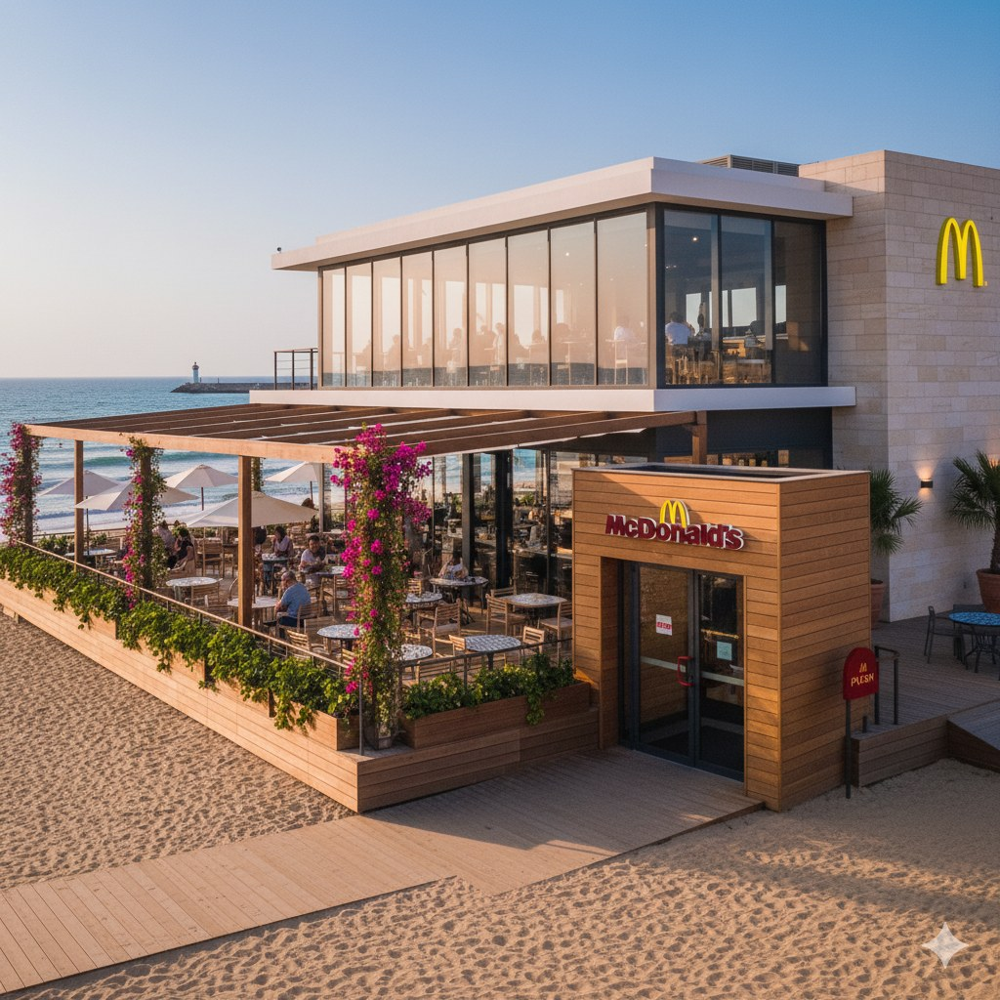
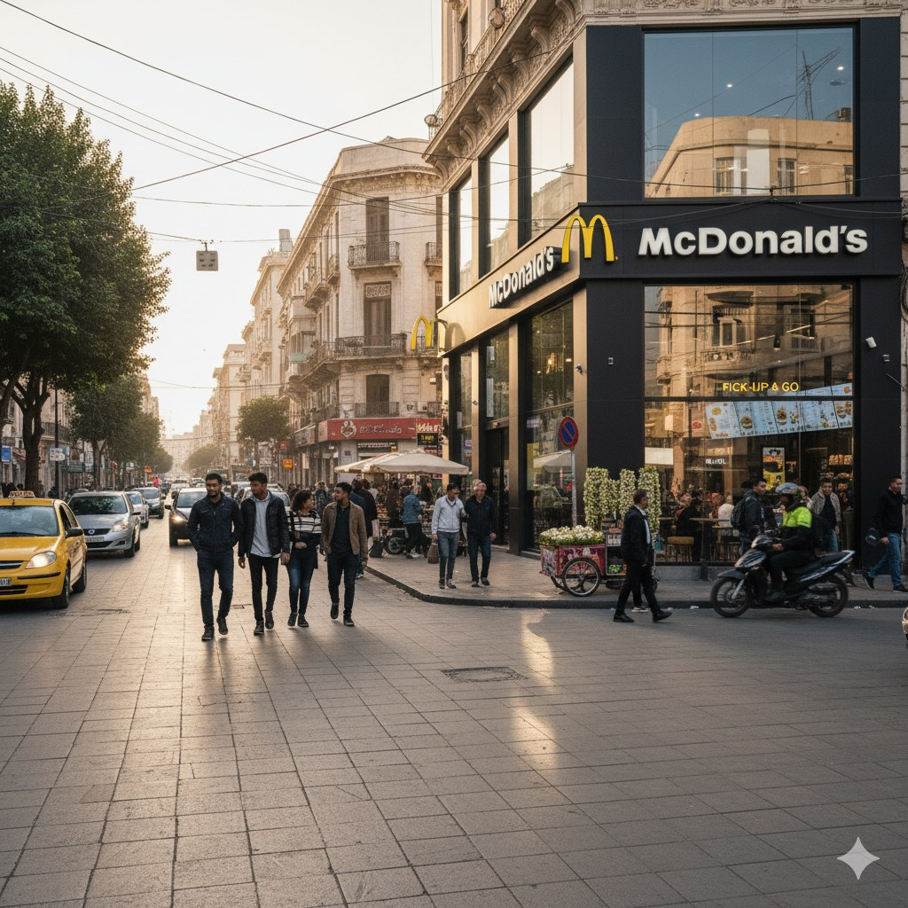
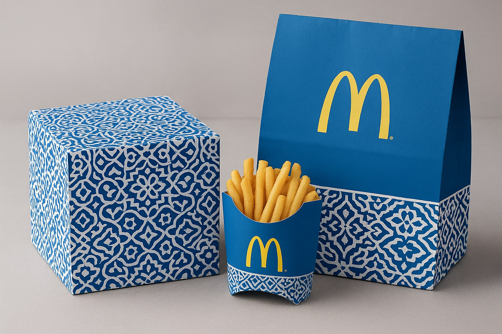

# McTounsi: McDonald's Tunisia Market Entry Strategy

An academic International Marketing team project exploring how McDonald's could hypothetically adapt its marketing mix for Tunisia. The concept, **McTounsi — Where Global Meets Local**, is a student proposal, not a real McDonald's plan, client engagement, or approved expansion strategy.

> **Independent academic work.** This project is not affiliated with or endorsed by McDonald's Corporation. McDonald's names and marks belong to their respective owners. The concept images are AI-generated illustrations, not actual restaurants, products, or launch materials.

## Project focus

The team explored how to balance global brand consistency with local cultural relevance through:

- Segmentation, targeting, and positioning for youth, families, professionals, and tourists.
- A localized product and promotion mix organized around the project concept "McTounsi."
- Four proposed restaurant formats: City Hub, Beach and Suburban, Drive-Thru and Delivery, and McRoute highway stops.
- Entry, pricing, partnership, and risk recommendations.

These are strategic concepts only. The project includes no implementation, financial model, validated consumer research, or measured business outcomes. Some rollout sequencing in the documents is explicitly identified as team interpretation.

## Evidence limits

The project working document's appendix lists estimates such as Tunisia's population, youth share, tourist arrivals, and smartphone penetration. The supplied materials do not provide traceable external citations or datasets for those figures. Treat them as unverified project inputs, not current market facts. The case also lacks a formal SWOT, PESTEL, competitor benchmarking, and financial analysis.

## Explore the project

- [Executive summary](docs/Executive-Summary.md)
- [Country analysis](docs/Country-Analysis.md)
- [Market research](docs/Market-Research.md)
- [Competitor analysis](docs/Competitor-Analysis.md)
- [STP strategy](docs/STP-Strategy.md)
- [Market entry strategy](docs/Market-Entry-Strategy.md)
- [Marketing mix](docs/Marketing-Mix.md)
- [Risk analysis](docs/Risk-Analysis.md)
- [Recommendations](docs/Recommendations.md)
- [Project structure and reading guide](PROJECT_STRUCTURE.md)

The original file was a shared team working document with informal work-in-progress notes, so it is kept out of the public repository. The Markdown files are a portfolio-oriented summary of the project.

## AI concept visuals

All restaurant and packaging mockups in `assets/images/` were generated as illustrations for this academic project. They do not depict real McDonald's locations or products.

| Beach concept | City Hub concept | Packaging concept |
|---|---|---|
|  |  |  |

## Team and reuse

This was collaborative course work. The repository describes it as a team project and makes no individual contribution claims. No reuse license is granted for the team's shared work; third-party brand marks remain their owners' property.
