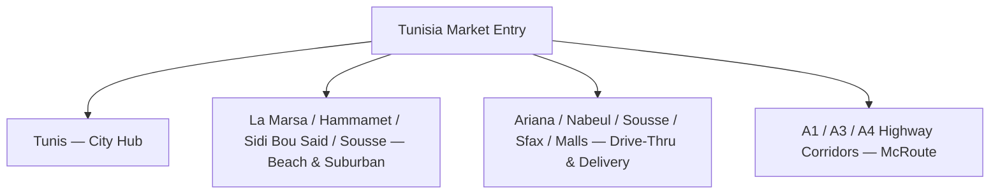

← [Back to README](../README.md)

# Country Analysis: Tunisia

## Purpose

This document summarizes the market-level indicators the team used to justify Tunisia as a viable McDonald's entry market. These figures were compiled by the team as supporting context (presentation appendix) rather than as a full macro-environmental (PESTEL) study — no PESTEL analysis was produced as part of this project, so none is presented here.

## Market Snapshot

| Indicator | Figure | Strategic Implication |
|---|---|---|
| Population | ~12 million | Sufficient national scale to support a multi-format restaurant network |
| Population under 30 | ~60% | A youth-majority market — supports a digital-first, socially-driven promotion strategy and a City Hub / student-focused format |
| Annual tourist arrivals | 9+ million | Meaningful transient demand, particularly in coastal areas — supports the Beach & Suburban format and "Tourist Pack" pricing tier |
| Smartphone penetration | 70%+ | Viable base for app-based ordering, dynamic pricing, and delivery-platform partnerships |

## Consumer Purchasing Power Context

The team's pricing rationale (see [Marketing Mix — Price](Marketing-Mix.md#price)) is built on the following market reads, rather than formal income-distribution data:

- **Lower average purchasing power** relative to McDonald's home markets, especially among students and young professionals — this directly shapes the case for penetration pricing.
- **Cultural expectation of generous portion sizes** at reasonable prices, shaped by local reference points like fricassée and mlewi.
- **A crowded, low-fixed-cost informal food sector** (local fast-food shops, street vendors, affordable cafés) that keeps price expectations anchored low.

## Competitive Density

The market read used by the team (see [Competitor Analysis](Competitor-Analysis.md)) characterizes Tunisia as having a **limited international fast-food footprint** alongside a **strong, deeply rooted street-food culture** — read as an opening for a first-mover, culturally adapted entrant in the premium fast-casual space.

## Geographic Focus Areas

The strategy repeatedly references a specific set of cities and coastal towns as priority locations, rather than a uniform nationwide rollout:

## Data Availability Note

The uploaded project materials did not include GDP, inflation, currency, trade-policy, or political-risk data. In line with the project's actual scope, no PESTEL or macroeconomic modeling is presented here — only the market indicators the team explicitly cited.

---

**Previous:** [← Executive Summary](Executive-Summary.md) · **Next:** [Market Research →](Market-Research.md)
