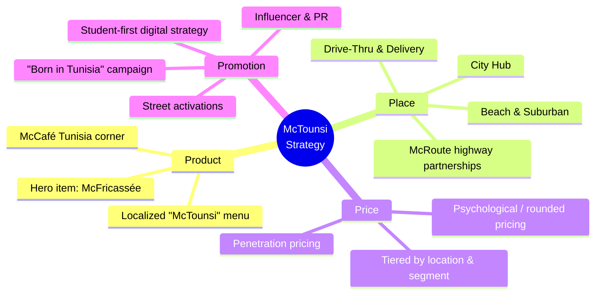

← [Back to README](../README.md)

# Executive Summary

## The Brief

Design a market entry strategy for **McDonald's in Tunisia** that resolves the central tension of international expansion: how to preserve McDonald's global brand consistency while genuinely adapting to Tunisian culture, tastes, and purchasing power.

## The Concept: McTounsi — Where Global Meets Local

The team's answer is a brand concept called **McTounsi**: a McDonald's experience that *"tastes Tunisian, feels Tunisian, and lives Tunisian — but stays unmistakably McDonald's."* This is not a rebrand; it is a **localization layer** applied across every element of the marketing mix, from menu to store design to pricing to promotion.

## Strategic Approach

## Who the Strategy Targets

The team segmented the Tunisian market into four core groups — **Youth, Professionals, Families, and Tourists** — each with distinct needs (fun & digital spaces, speed & convenience, comfort & quality time, and authenticity, respectively). Rather than building one restaurant format for everyone, the strategy proposes a **multi-format ecosystem** that serves each segment appropriately while keeping one unified brand identity. Full detail in [Market Research](Market-Research.md) and [STP Strategy](STP-Strategy.md).

## What Makes This Strategy Distinct

| Pillar | Standard QSR Entry Playbook | McTounsi Approach |
|---|---|---|
| Menu | Global menu with minor local additions | Fully reimagined local menu line, anchored by a signature hero product |
| Format | One store template scaled nationally | Three differentiated formats (City / Beach / Drive-Thru) sharing one brand DNA |
| Expansion | Owned real estate build-out | Co-branded partnerships with fuel retailers for highway rest-stop locations (McRoute) |
| Pricing | Global price architecture with light local adjustment | Tiered, psychologically-rounded pricing calibrated to Tunisian purchasing power and location |
| Promotion | Mass media-led launch | Grassroots-first: street sampling, influencer PR, then mass "Born in Tunisia" campaign |

## Key Recommendations at a Glance

1. Launch with a **focused, hero-product-led local menu** rather than a full menu overhaul — see [Marketing Mix](Marketing-Mix.md).
2. Roll out **City Hub and Beach formats first**, treating highway co-branded **McRoute** locations as a phase-two national expansion lever — see [Market Entry Strategy](Market-Entry-Strategy.md).
3. Price using **penetration and psychological pricing** to avoid an "elitist" perception versus street food competitors — see [Marketing Mix](Marketing-Mix.md).
4. Build cultural credibility through **local promotion first** (street tours, influencers, student offers) before scaling to mass media — see [Marketing Mix](Marketing-Mix.md).
5. Treat the **youth/student segment as a long-term loyalty engine**, not just a short-term discount audience.

## Scope Note

This summary — and this repository — reflect the analysis actually developed by the project team. Formal SWOT, PESTEL, and financial/ROI modeling were not part of the delivered scope and are therefore not included; see [Future Improvements](../README.md#-future-improvements) in the README for what a next iteration could add.

---

**Next:** [Country Analysis →](Country-Analysis.md)
