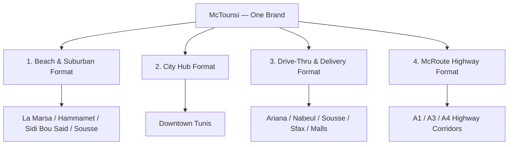
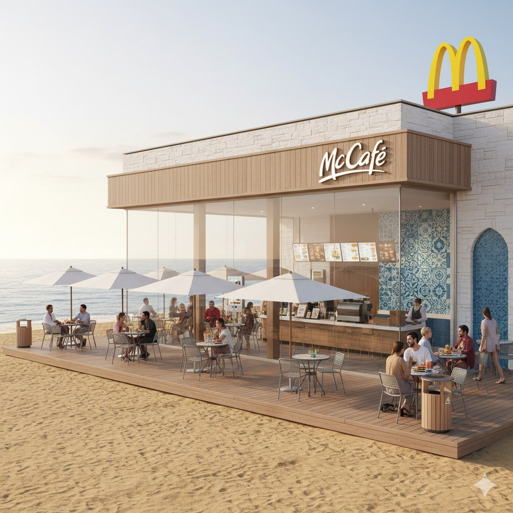
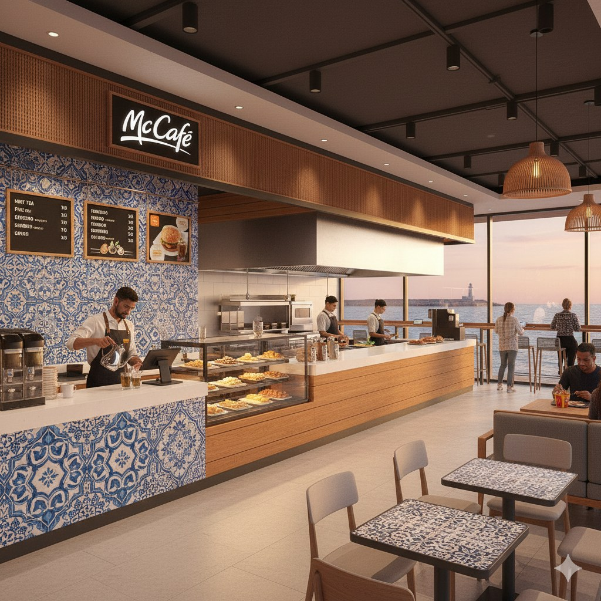
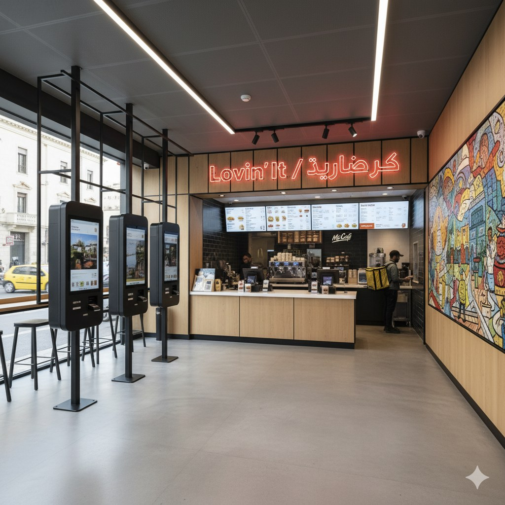
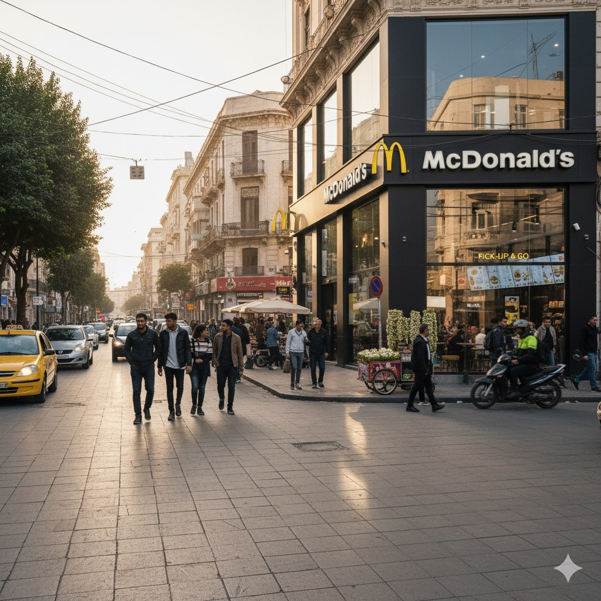
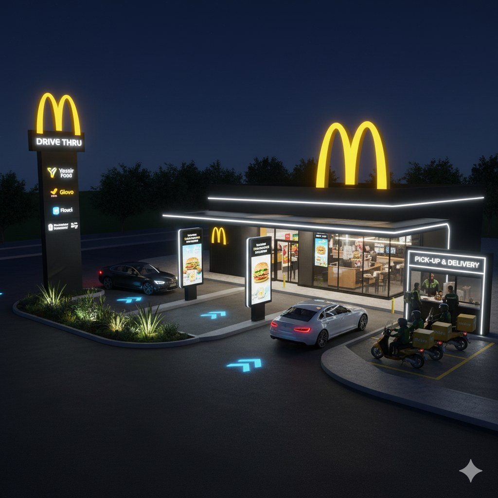
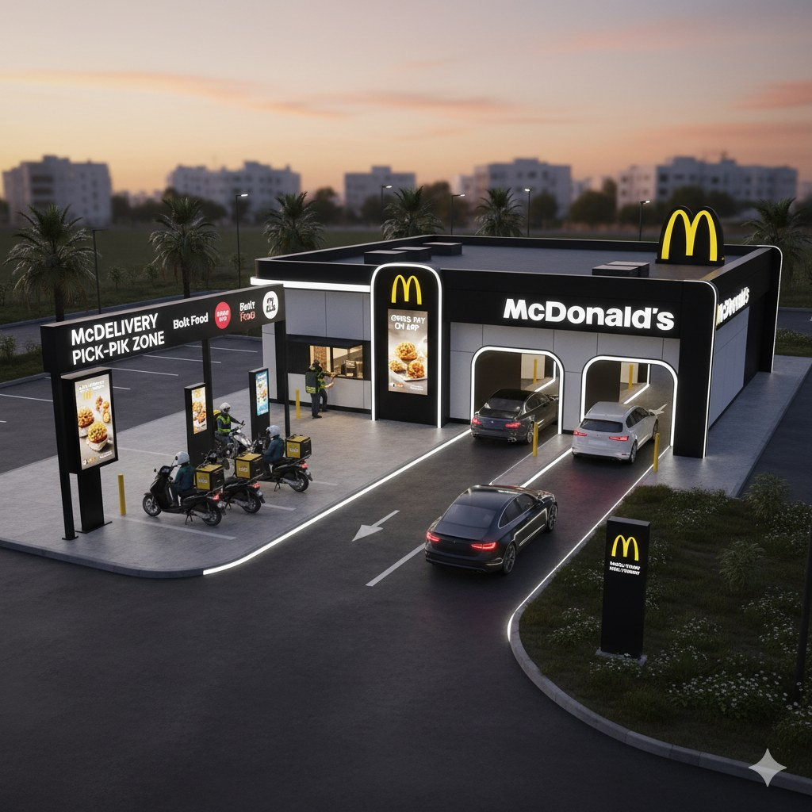
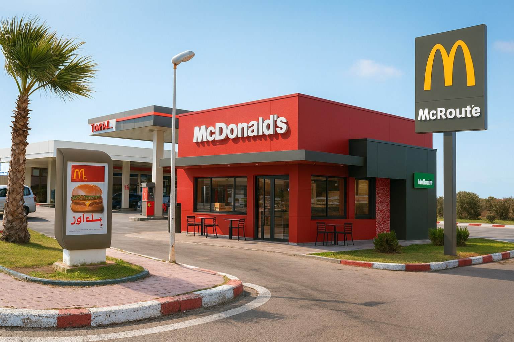
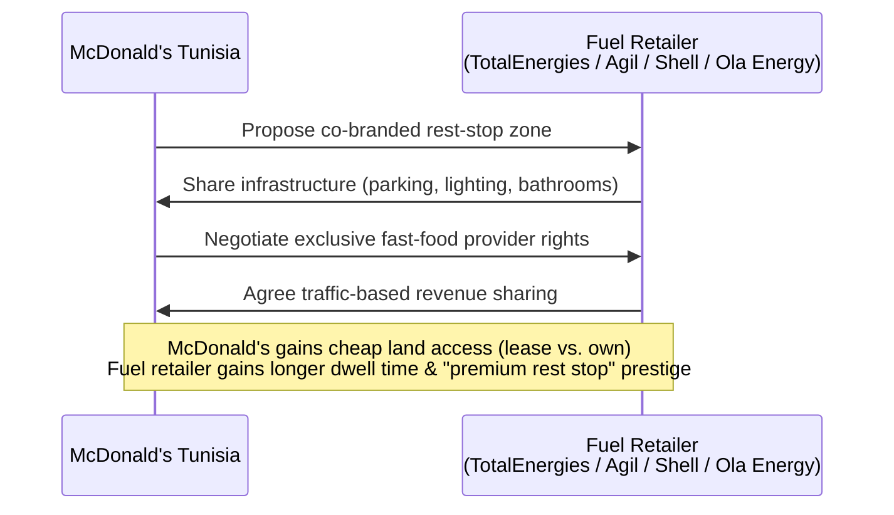
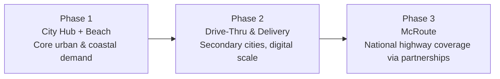

← [Back to README](../README.md)

# Market Entry Strategy

## Entry Philosophy

The strategy is built around a **multi-format brand ecosystem** rather than a single restaurant template scaled uniformly. Every format shares the same core brand DNA but is tailored to the consumer segment and geography it serves (see [STP Strategy](STP-Strategy.md)).

> *"We need to make sure McDonald's Tunisia feels like one brand — not three different restaurants. We'll keep the same soul and adapt the experience."*

## Shared Brand Constants (Across All Formats)

| Constant | Description |
|---|---|
| Color identity | McDonald's red and gold blended with Tunisian flag colors |
| Local materials | Light wood, mosaic accents, bilingual (Arabic/French) signage |
| Sustainability | Eco-friendly materials and smart, green design |
| McCafé Tunisia corner | Present in every format (mint tea, local sweets) |
| Slogan | Original "Lovin' It..." with a Tunisian twist — **#LovinItTounsi** |
| Sensory branding | Signature scent (jasmine + grilled bun), Arabic lofi/oud-blend music ambiance |

## Format Ecosystem

### 1. Beach & Suburban Format

Positioned on the Mediterranean coast, targeting families and tourists. Features large glass walls, ocean views, outdoor terraces, mosaic tables, and a dedicated McCafé corner. Design references include a "McView Corner" seaside terrace, a bilingual mosaic art wall created by a local Tunisian artist, and sand/salt-resistant outdoor furniture.

### 2. City Hub Format

A compact, urban-styled format in downtown Tunis built for speed and digital-first customers (students, young professionals). Features include a vertical green wall with rotating local street-art collaborations, an LED "Today's Pick" digital menu wall, and a community study table with charging ports.

### 3. Drive-Thru & Delivery Format

Located in secondary cities and mall entrances (Ariana, Nabeul, Sousse, Sfax), optimized for digital payments and delivery-platform partnerships (Glovo and similar). Concepts include a Tunisian-dialect AI order voice and a dedicated "Refuel Zone" for delivery drivers.

### 4. McRoute — Highway Rest-Stop Format

A distinct fourth format proposed to extend reach beyond major cities: compact McDonald's / McCafé-express units embedded directly inside national highway rest stops on the **A1, A3, and A4 autoroutes**.

#### Strategic Partnership Model

McRoute is designed as a **capital-light expansion channel** through co-branded partnerships with fuel retailers rather than standalone real estate acquisition.

| Party | What They Gain |
|---|---|
| Fuel retailer | Increased customer traffic, longer dwell time (fuel + food + coffee), higher brand prestige as a "premium rest stop" |
| McDonald's | Cheap land acquisition via lease instead of ownership, guaranteed daily driver/traveler flow, presence outside major cities |

#### McRoute Menu Adaptation

| Need | Menu Response |
|---|---|
| Easy to eat in the car | McTabga, Brik Bites, McFricassée |
| Long drives | Extra-large McCafé coffee cups |
| Group/road-trip sharing | "Road Snack Packs" (6–9 piece sharables) |
| Seasonal/road-trip occasions | Mint lemonade, "Driver's Breakfast Box" |

## Recommended Sequencing

The source materials present all four formats as part of one ecosystem without an explicit rollout timeline. Based on the strategic logic in the materials (population density, existing local competition, and capital intensity), the most defensible sequencing is:

*This phasing is an interpretation built on the team's stated logic, not an explicit rollout plan from the source materials — it is flagged here as inference rather than presented as a direct project finding.*

---

**Previous:** [← STP Strategy](STP-Strategy.md) · **Next:** [Marketing Mix →](Marketing-Mix.md)
