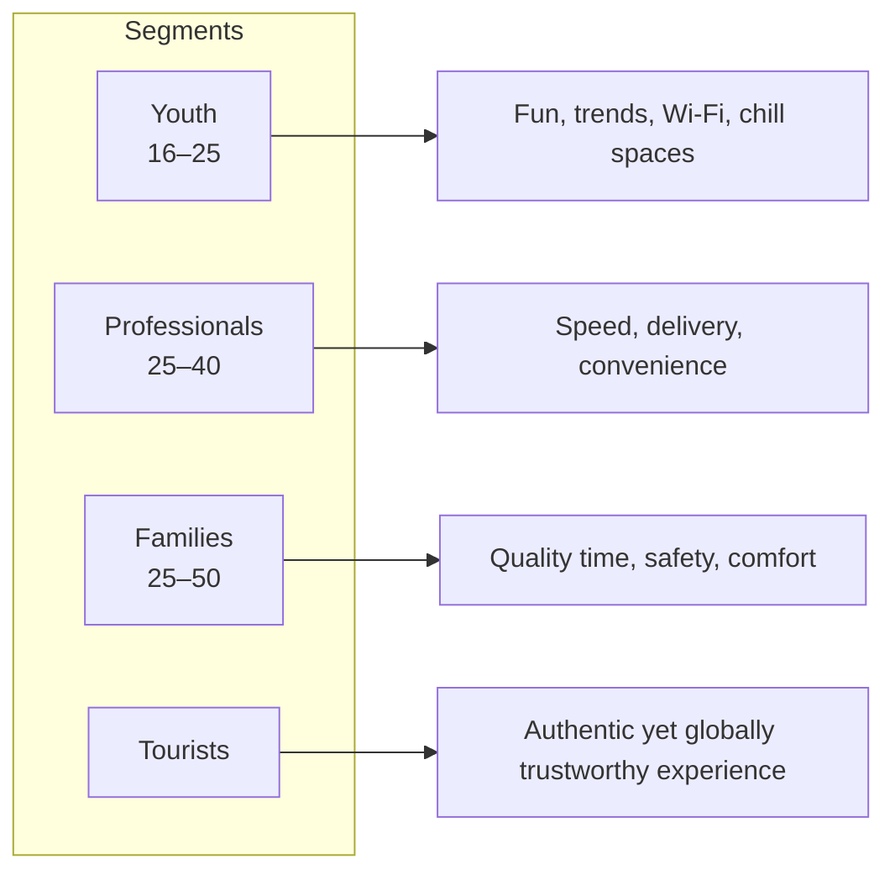

← [Back to README](../README.md)

# Market Research: Understanding Tunisian Consumer Lifestyles

## Research Approach

Rather than commissioning primary research (surveys/interviews — not part of this project's scope), the team built its market read from **observed lifestyle and consumption patterns** across four consumer archetypes present in Tunisia. This qualitative segmentation directly informs the [Market Entry](Market-Entry-Strategy.md) format ecosystem and the [Marketing Mix](Marketing-Mix.md).

## The Four Core Segments

| Segment | Age Range | Core Needs | Primary Format Match |
|---|---|---|---|
| Youth | 16–25 | Trends, digital connectivity, social spaces, Wi-Fi | City Hubs |
| Professionals | 25–40 | Speed, convenience, delivery | City Hubs & Drive-Thru |
| Families | 25–50 | Comfort, safety, quality time | Beach & Suburban branches |
| Tourists | — | Authentic yet globally consistent experience | Beach branches |

## Key Research Insight

> *"Solution: An Ecosystem Approach — Not One Format, But Multiple Tailored Experiences."*

This single insight is the foundation of the entire go-to-market strategy: Tunisia's consumer base was judged too diverse for a single restaurant template, which is why the team designed a **multi-format brand ecosystem** instead of a one-size-fits-all rollout (see [Market Entry Strategy](Market-Entry-Strategy.md)).

## Behavioral Signals Used to Shape the Strategy

| Signal | Where It Shows Up in the Strategy |
|---|---|
| High youth population share and social media usage | Digital-first promotion, TikTok challenges, student pricing tier |
| Strong social/shared dining culture | Sharable menu formats (Brik Bites, Cherkaw Bites boxed like nuggets) |
| High tourism volume, especially coastal | Beach format, "Taste of Tunisia" tourist pricing tier |
| Price sensitivity vs. local street food | Penetration pricing strategy (see [Marketing Mix](Marketing-Mix.md#price)) |
| High regard for generous, home-style portions | Menu design choices (e.g., McTajine Side Dish, family bundles) |

## Data Availability Note

The team's research is qualitative and observational; no quantitative consumer survey data, focus-group findings, or demand forecasts were part of the delivered materials, so none are presented here.

---

**Previous:** [← Country Analysis](Country-Analysis.md) · **Next:** [Competitor Analysis →](Competitor-Analysis.md)
