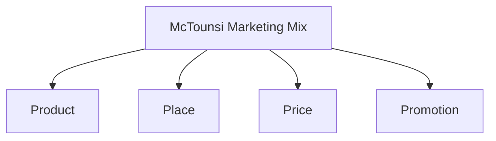
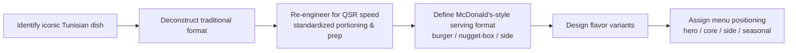
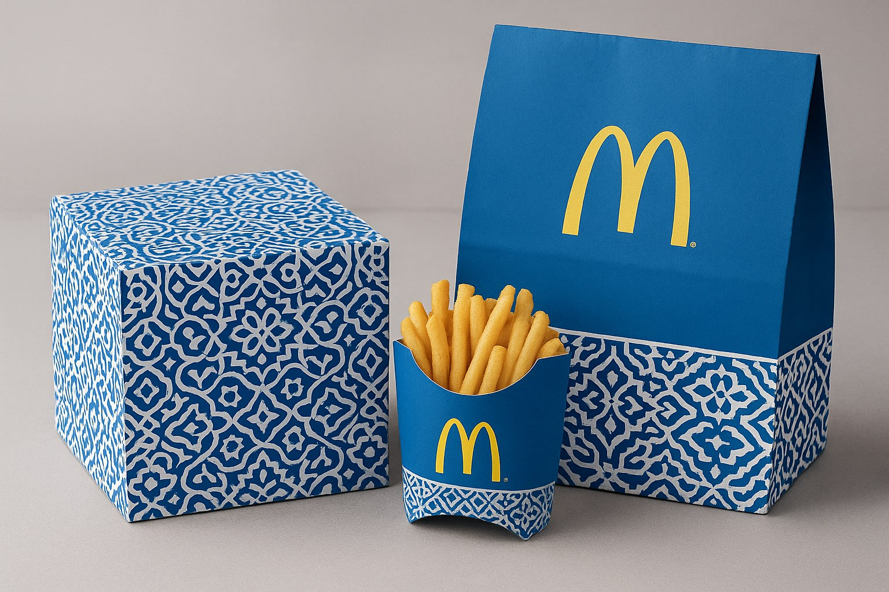
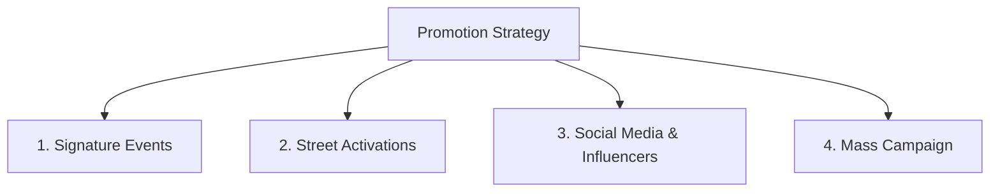
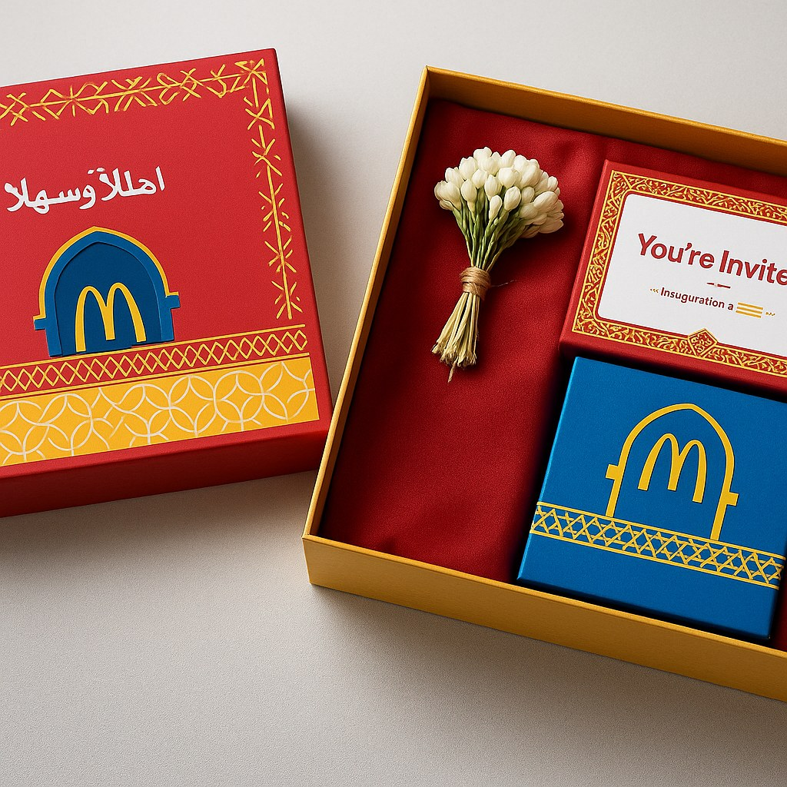

← [Back to README](../README.md)

# Marketing Mix: The 4Ps of McTounsi

## Overview

Jump to: [Product](#product) · [Place](#place) · [Price](#price) · [Promotion](#promotion)

---

## Product

The product strategy adapts Tunisian street food and home-style cooking into a standardized, fast-food-ready menu — retaining recognizable flavor identity while re-engineering format, portioning, and preparation for QSR speed and consistency.

### Hero Product: McFricassée

A fusion of the classic McDonald's burger with Tunisia's iconic fricassée sandwich, served in a lightly fried, golden fricassée-style bread roll instead of a traditional bun.

| Element | Traditional Fricassée | McFricassée Adaptation | Rationale |
|---|---|---|---|
| Bread | Rustic fried dough, irregular shape | Standardized, pre-formed, deep-fried oval roll | Consistent size, rapid heating, easy packaging |
| Filling | Harissa, olives, slata mechouia | "Build-your-own" stacked layers: bread → slata mechouia → harissa-mayo → patty → tomatoes → lettuce → olives/pickles → top bread | Fits McDonald's standard assembly-line process |

**Variants:** McFricassée Original (beef, harissa-mayo, lettuce, tomato, olives), McFricassée Spicy (extra harissa + mechouia), McFricassée Chicken (crispy chicken filet).

### Full "McTounsi" Menu Line

| Product | Inspired By | Format | Notes |
|---|---|---|---|
| **McFricassée** | Fricassée sandwich | Burger | Hero/flagship item |
| **McTabga** | Mtabga (stuffed bread) | Folded pastry pocket, "Local Signature Sandwich" | Fillings: harissa chicken & cheese, ground beef & onion, or spinach/egg/cheese (vegetarian) |
| **Brik Bites** | Brik | 6 or 9-piece box (like nuggets) | Fillings: egg & tuna, cheese, or potato & harissa; served with harissa-mayo dip |
| **Ftayer Cherkaw (Savory Bites)** | Ftayer cherkaw (Monastir) | 6 or 9-piece sharable box | Positioned as a fish-based "nuggets alternative"; dips include harissa-mayo, mechouia, garlic-mayo |
| **McTajine Slice** | Tunisian tajine | Side dish slice | Variants: classic (chicken & potato), cheese, spinach |
| **Mergshuka McStack** | Merguez & shakshuka | Burger/stack | Mini merguez-style patties, shakshuka layer, optional runny egg, harissa-tomato touch |
| **Harissa-Honey McNuggets + Spiced Olive-Oil Fries** | — | Combo | Sweet-spicy harissa glaze on nuggets; fries tossed in olive oil with za'atar/cumin |
| **McBeldi Burger** | — | Burger | Harissa mayo, grilled peppers, Tunisian cheese |
| **McSea Burger** | — | Burger (Beach format exclusive) | Fried fish, lemon sauce, mint |

### Desserts

| Product | Inspired By | Notes |
|---|---|---|
| **McYoyo** | Yoyo (Tunisian donut) | Lighter, coated rather than drenched; variants: classic honey, sugar-coated, chocolate-drizzled, orange blossom |
| **Mkharek Stuffed With Cream** | Mkharek | Filled with vanilla custard/whipped cream; variants: classic, pistachio, chocolate |
| **Baklawa McFlurry** | Baklawa | Soft-serve with pistachio-almond crumble and orange-blossom syrup swirl |
| **Date-Caramel Pocket** | — | Warm date-paste and almond pocket with sesame glaze |
| **Bambalouni-Twist Donut** | Bambalouni | Lighter take, honey-sesame or sugar finish |
| **Makroud McFlurry** | Makroud | With dates and honey |

### McCafé Tunisia Corner

| Offering | Description |
|---|---|
| McMint Tea / McMint Lemonade | Local beverage adaptation |
| Sea Salt Caramel Milkshake, Date Milkshake | McCafé-style shakes with local flavor twist |
| Zgougou Latte | Local pine-nut dessert flavor adapted to coffee format |
| Kaak Warka Dessert | Local pastry offering |
| Bambalouni Sundae | Mini bambalouni pieces served on ice cream |

### Sides & Beverage Additions

- Pickled peppers and radishes (Torshi) as a side option.
- Local soda brands (Boga, Apla, Viva, Punch) added to the beverage lineup and used in combo bundling.
- Ftayer offered as a breakfast-menu alternative to Hotcakes.

### Ramadan & Seasonal Product Bundles

- **Ramadan Chakan Fatr Bundles**: balanced ftour/sahri sets combining a savory item, dates, a warm/cold drink, and a soup or side, respecting the fasting-month eating rhythm.
- **Eid Customizable Sweet Boxes**: pre-order boxes for gifting, allowing families to select their sweet mix and portion size.

### Product Development Process (as applied by the team)

---

## Place

### Strategy Summary

The Place strategy builds a **multi-experience ecosystem** rather than one restaurant template, matching restaurant formats to the four consumer segments identified in [Market Research](Market-Research.md). Full description of each format, the McRoute partnership model, and recommended sequencing is documented in **[Market Entry Strategy](Market-Entry-Strategy.md)** to avoid duplication — this section summarizes the Place-specific brand execution details.

### Iconic In-Store Details (Shared Across Formats)

| Touchpoint | Detail |
|---|---|
| Uniforms | Beige & white with mosaic-pattern collars, embroidered Arabic "نحبوها" (We love it) |
| Trays | Bilingual motivational phrases ("Spread Joy" / "فرّح غيرك") printed under the paper mat |
| Packaging | Eco-friendly kraft paper featuring Tunisian symbols (door handles, jasmine, waves) |
| Music | Soft blend of Arabic lofi, oud beats, and chillwave pop |
| Scent | Jasmine mixed with grilled bun aroma, subtly diffused in-store |
| Hashtag | #LovinItTounsi |

---

## Price

### Why Pricing Must Be Adaptive

| Factor | Implication |
|---|---|
| Lower purchasing power, especially among students/young professionals | Prices must stay accessible, not premium-positioned |
| Cultural expectation of large, filling portions at reasonable prices | Value perception is tied to portion size, not just price |
| Strong low-fixed-cost competition (street vendors, local fast-food, cafés) | McDonald's must avoid being perceived as "elitist" |

### Pricing Model

| Principle | Application |
|---|---|
| **Penetration pricing** | Priced slightly above street food but below premium cafés — "a bit better than local fast food but still within reach" |
| **Psychological / rounded pricing** | Clean price points (e.g., 6 DT, 8.5 DT) rather than .99-style pricing — perceived as fairer and more culturally consistent |
| **Competitive benchmarking** | Core menu items (e.g., Big Mac, McChicken-equivalents) priced at or slightly below leading local non-traditional fast-food competitors (Baguette et Baguette, Hobo) |
| **Location-based segmentation** | Higher prices in affluent/tourist zones (e.g., Les Lacs); lower prices near universities and business districts |
| **Value/loss-leader tier** | A localized **"McDinar Menu"** with snack-sized items (mini McFricassée, slata mechouia, sodas) priced 1–5 TND to drive footfall |
| **Bundle pricing** | Combo bundles for professionals on the go, casual outings, or study breaks |
| **Dynamic pricing via app** | Lower prices during off-peak hours (e.g., 3–6 PM) |

### Price Points by Tier

| Tier | Example Offer | Price (TND) |
|---|---|---|
| Value / McDinar Menu | Snack-sized starters (mini items, sides, sodas) | 1–5 |
| Breakfast items | Standard breakfast menu | 5–10 |
| Main meals | Core menu items | 8–12 |
| Student bundle | "McStudy Box" (burger + fries + coffee) | 15 |
| Family bundle | "McFamily Beach Box" (4-person seafood/burger mix) | 35–45 |
| Tourist bundle | "Taste Tunisia Menu" (international + local special) | 65 |

### Seasonal & Segment-Based Pricing

- **Ramadan/Eid pricing:** manageable ftour/sahri bundle prices and dedicated Eid box pricing.
- **Student pricing:** 20% discount with a valid student card, positioned as a loyalty-building investment given Tunisia's youth-driven demographics.
- **Occasional promotions:** BOGO-style deals to maintain excitement at key moments.

---

## Promotion

### Strategic Pillars

### 1. Signature Events

| Event | Description |
|---|---|
| McBeach Festival | Summer pop-up with live music, burgers, and sea breeze at Beach format locations |
| Study & Chill Nights | City Hub opens late during exam periods with coffee deals for students |
| McDrive Movie Night | Drive-in movie experience in the parking area with in-car audio |

### 2. Street Activations — "Taste of Tunisia" Street Tour

Pop-up sampling stands placed in high-footfall locations: **Avenue Habib Bourguiba, Marsa Corniche, Sidi Bou Said, Sousse, Sfax.** Visitors receive free mini samples of the localized menu and play interactive booth games while learning about the brand — designed to build hype, reach potential customers, and connect the brand to Tunisian street culture.

### 3. Social Media, Influencer & PR Strategy

| Tactic | Description |
|---|---|
| Influencer partnerships | Collaboration with local, authentic Tunisian influencers and food bloggers |
| PR packages | Sent to influencers to drive grand-opening coverage and follower reach |
| TikTok challenge | Customers film raw reactions to new Tunisian menu items; top videos featured on in-store screens |
| Limited-edition packaging | Designs inspired by Sidi Bou Said colors/motifs and red-pepper imagery, intended to be kept and shared on social media |

### 4. Mass Campaign — "Born in Tunisia"

A cinematic launch ad distributed across TV, radio, and social media, filmed in a Tunisified context (e.g., Avenue Habib Bourguiba's Clock Tower), using **Tunisian dialect (Derja)**, local humor, and a Tunisian-style jingle. Core message: *"Our taste is Tunisian."* Designed to combine emotional pride with global brand credibility.

### Student-Focused Promotion

Given Tunisia's youth-majority demographic, a dedicated student strategy is layered across the promotion mix:

| Tactic | Description |
|---|---|
| Student discounts | 20% off with student card |
| Campus activations | Direct sampling and engagement events near universities |
| Menu-Étudiant | Affordable offers targeted at university-adjacent restaurant locations |
| Digital-first messaging | Meme culture and trend-responsive content on TikTok/Instagram |

### Seasonal & Cultural Marketing

- **Ramadan:** special menu timing and items.
- **Summer:** beach-focused, refreshing product pushes.
- **National holidays:** limited editions and festive packaging.

### Combo Partnerships

Bundling with popular local beverage brands (**Boga, Viva, Punch**) to reinforce local relevance in combo meals.

---

**Previous:** [← Market Entry Strategy](Market-Entry-Strategy.md) · **Next:** [Risk Analysis →](Risk-Analysis.md)
