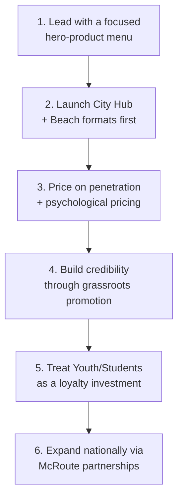

← [Back to README](../README.md)

# Strategic Recommendations

## Purpose

This document consolidates the strategic implications of the analysis in this repository into a prioritized set of recommendations. Each recommendation is traceable to the underlying analysis it draws from — nothing here introduces new data beyond what the team documented.

## Recommendation Roadmap

## 1. Lead With a Focused, Hero-Product Menu

Rather than relaunching the entire McDonald's menu simultaneously, anchor the Tunisia launch around **McFricassée** as the flagship "Tunisian signature" item, supported by a small set of high-conviction items (Brik Bites, McTajine Slice, McYoyo). This reduces launch complexity and gives the brand a clear, ownable story: *"something people would try because it's something McDo has nowhere else."*
→ Full menu detail: [Marketing Mix — Product](Marketing-Mix.md#product)

## 2. Sequence the Format Rollout — City Hub and Beach First

Prioritize **City Hub** (urban, student/professional demand) and **Beach & Suburban** (family/tourist demand) formats in the initial rollout, since these map to the segments with the clearest, most immediate demand signals identified in [Market Research](Market-Research.md). Treat **Drive-Thru & Delivery** as a second-wave format for secondary cities, and **McRoute** as a longer-horizon national expansion lever once the brand and operating model are proven.
→ Full detail: [Market Entry Strategy](Market-Entry-Strategy.md)

## 3. Price on Penetration, Not Premium

Set core menu pricing **at or slightly below leading local non-traditional fast-food competitors** (e.g., Baguette et Baguette, Hobo), using rounded, psychologically simple price points. This directly protects against the single biggest positioning risk identified in the strategy: being perceived as an "elitist" import rather than an accessible everyday option.
→ Full detail: [Marketing Mix — Price](Marketing-Mix.md#price)

## 4. Build Credibility Bottom-Up Before Scaling Mass Media

Sequence promotion so that **street activations, influencer PR, and sampling tours** ("Taste of Tunisia" street tour) establish grassroots authenticity *before* the brand leans on its mass "Born in Tunisia" campaign. This lets the brand earn cultural credibility rather than simply announcing it.
→ Full detail: [Marketing Mix — Promotion](Marketing-Mix.md#promotion)

## 5. Treat the Youth/Student Segment as a Long-Term Loyalty Investment

Given that ~60% of Tunisia's population is under 30 (see [Country Analysis](Country-Analysis.md)), student-focused tactics (discounts, campus activations, Study & Chill Nights) should be resourced as a **habit-formation and long-term loyalty play**, not a short-term discount lever — consistent with the team's own framing of this segment as "the perfect target."
→ Full detail: [STP Strategy — Targeting](STP-Strategy.md#2-targeting)

## 6. Use McRoute Partnerships as the National Scale-Up Engine

Once the core urban and coastal formats are validated, expand national coverage through **co-branded partnerships with fuel retailers** (TotalEnergies, Agil, Shell, Ola Energy) rather than direct real estate ownership. This keeps capital intensity low while extending the brand's reach along Tunisia's major highway corridors.
→ Full detail: [Market Entry Strategy — McRoute](Market-Entry-Strategy.md#4-mcroute--highway-rest-stop-format)

## Recommended Next Steps Beyond This Project's Scope

These follow directly from the [Risk Analysis](Risk-Analysis.md) and are also listed in the [README](../README.md#-future-improvements):

- Conduct formal **SWOT** and **PESTEL** analysis to stress-test the qualitative market read.
- Build a **unit-economics model** per format (City Hub, Beach, Drive-Thru, McRoute) to validate the pricing tiers against real cost structures.
- Run **primary consumer research** to validate the four-segment model before full-scale investment.
- Develop a **structured competitor benchmarking table** with pricing and footprint data to sharpen the positioning claims in [Competitor Analysis](Competitor-Analysis.md).

---

**Previous:** [← Risk Analysis](Risk-Analysis.md) · **Back to:** [README](../README.md)
