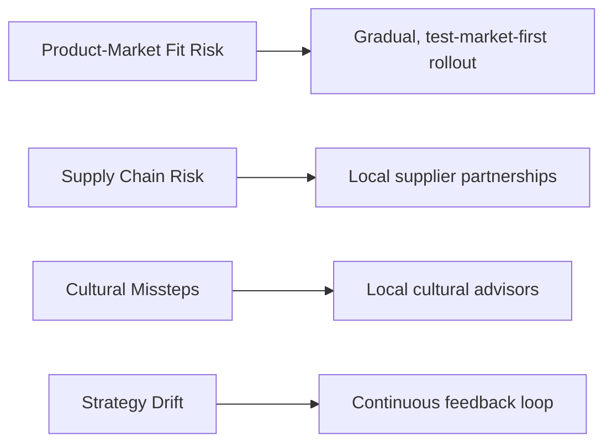

← [Back to README](../README.md)

# Risk Analysis

## Scope Note

The source materials include a short, appendix-level list of risk mitigation practices rather than a full quantified risk matrix (likelihood/impact scoring was not part of the delivered scope). This document presents what was actually provided, organized for clarity.

## Identified Risks & Mitigations

| Risk Area | Mitigation Identified by the Team |
|---|---|
| Menu/product-market fit uncertainty | Gradual rollout — test markets before national scale-up |
| Supply chain reliability for localized ingredients | Local partnerships for supply chain |
| Cultural missteps in menu development or messaging | Use of cultural advisors for menu development |
| Strategy drift after launch | Continuous feedback and adaptation post-launch |

## Additional Risk Signals Implied Elsewhere in the Strategy

While not framed explicitly as "risks" in the source material, the following pressures are addressed indirectly by other parts of the strategy:

| Implicit Risk | Where It's Addressed |
|---|---|
| Being perceived as "elitist" versus low-cost local competitors | Penetration and psychological pricing strategy — see [Marketing Mix — Price](Marketing-Mix.md#price) |
| Diluting McDonald's global brand identity through over-localization | Maintained brand constants (colors, slogan, McCafé corner) across every format — see [Market Entry Strategy](Market-Entry-Strategy.md) |
| High capital cost of national expansion | McRoute co-branded partnership model with fuel retailers — see [Market Entry Strategy](Market-Entry-Strategy.md) |
| Fragmented brand experience across formats | Explicit "one brand, not three restaurants" design principle — see [Market Entry Strategy](Market-Entry-Strategy.md) |

## Data Availability Note

No formal risk matrix (probability × impact scoring), financial risk exposure, or regulatory/political risk assessment was included in the source materials, so none is presented here.

---

**Previous:** [← Marketing Mix](Marketing-Mix.md) · **Next:** [Recommendations →](Recommendations.md)
