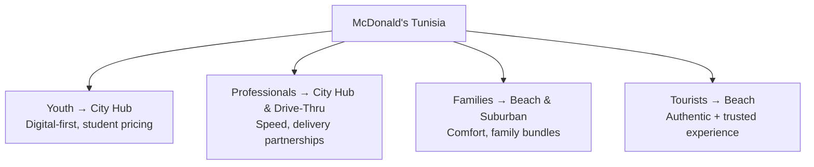
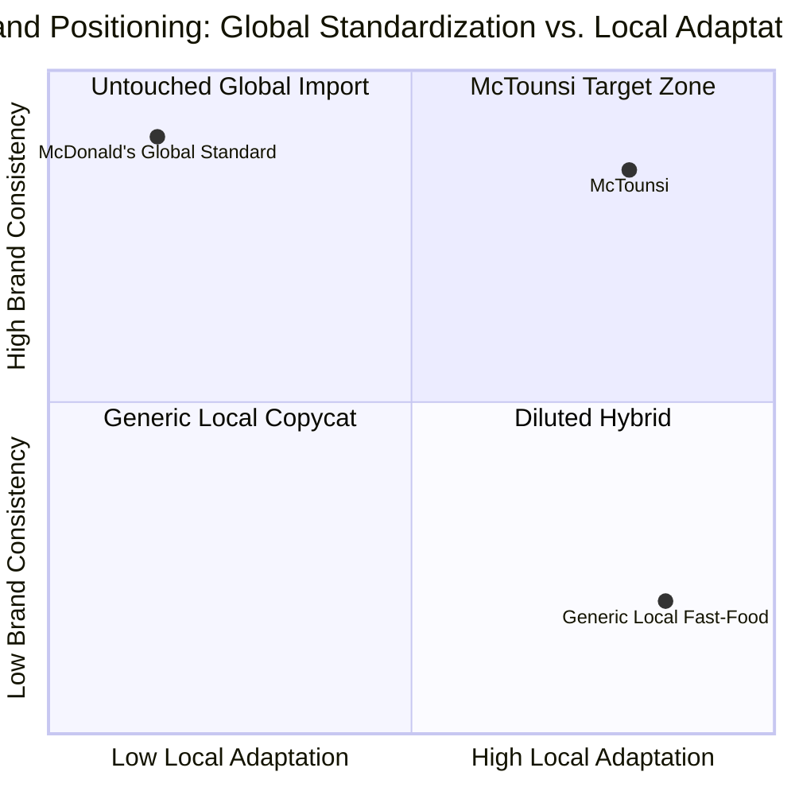

← [Back to README](../README.md)

# STP Strategy: Segmentation, Targeting, Positioning

## 1. Segmentation

The team segmented the Tunisian market into four lifestyle-based groups (full detail in [Market Research](Market-Research.md)):

| Segment | Defining Trait |
|---|---|
| Youth (16–25) | Digital, social, trend-driven |
| Professionals (25–40) | Time-poor, convenience-seeking |
| Families (25–50) | Comfort and quality-time seeking |
| Tourists | Seeking authenticity within a trusted global brand |

## 2. Targeting

Rather than choosing a single primary target, the strategy adopts a **differentiated targeting approach**: every segment is served, but through a different restaurant format and a tailored sub-strategy within the marketing mix.

Within this differentiated approach, **Youth/Students receive particular strategic emphasis** — the team frames this segment explicitly as a long-term loyalty-building investment ("Tunisia = super youth-driven market → perfect target"), not just a discount audience.

## 3. Positioning

### Positioning Statement (as expressed in the source material)

> *"A McDonald's that tastes Tunisian, feels Tunisian, and lives Tunisian... but stays unmistakably McDonald's."*

### Positioning Pillars

| Pillar | What It Means |
|---|---|
| Bold | Flavors and brand approach that don't shy away from local intensity (harissa, mechouia) |
| Social | Designed around Tunisia's shared, communal dining culture |
| Modern | Digital ordering, delivery integration, contemporary store design |
| Cultural | Deep, consistent Tunisian identity across every touchpoint — not a token menu item |

### Points of Parity vs. Points of Difference

| | McDonald's Global Standard (Point of Parity) | McTounsi Local Adaptation (Point of Difference) |
|---|---|---|
| Speed & consistency | Retained | — |
| Brand recognition (arches, red/gold) | Retained | Paired with Tunisian mosaic, blue, and Arabic bilingual identity |
| Core menu logic (combo meals, nuggets-style formats) | Retained | Filled with Tunisian recipes (fricassée, brik, ftayer) |
| Global "I'm Lovin' It" slogan | Retained | Localized with an Arabic/Tunisian twist and hashtag (#LovinItTounsi) |

## Positioning Map

---

**Previous:** [← Competitor Analysis](Competitor-Analysis.md) · **Next:** [Market Entry Strategy →](Market-Entry-Strategy.md)
